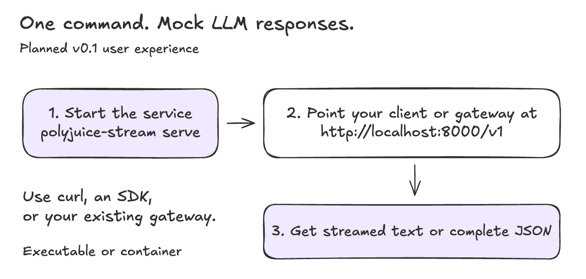
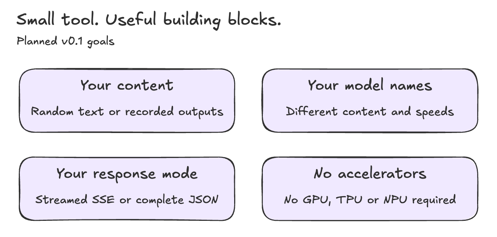

# Polyjuice Stream


**One command. Mock LLM responses. No accelerators.**

Turn random text or recorded LLM outputs into a model service for testing clients, gateways, routers and dispatchers—without running inference on a GPU, TPU or NPU.

> **Design stage:** v0.1 is not implemented or released yet. The commands and features below describe the planned experience.

## Designed to be easy

```sh
polyjuice-stream serve
```

Start with random output and no configuration. Point your client at `http://localhost:8000/v1`, using model name `mock-model`.



For recorded outputs or multiple models, use a [small configuration file](examples/configs/multi-model.yaml):

```sh
polyjuice-stream serve --config examples/configs/multi-model.yaml
```

Run the same service as a standalone Go executable or a container.

## v0.1 goals



- Replay JSONL records in order, ignoring prompts, or generate random text with an optional seed.
- Give each model its own content source, output length and pace.
- Support text Chat Completions with SSE (`stream: true`) or complete JSON (`stream: false`).

Output units are simulated text chunks, not real model tokens. See the [visual design](docs/design-v0.1.md) for timing, API scope and implementation steps.

## Why Polyjuice?

In Harry Potter, the [Polyjuice Potion](https://www.harrypotter.com/fact-file/plants-and-potions/polyjuice-potion) changes a person's appearance into another person's. Polyjuice Stream gives simulated responses the outward form of real LLM output, such as vLLM streams, without running the model.

[Design](docs/design-v0.1.md) · [HTTP contract](docs/http-contract.md) · [Repository layout](docs/repository-layout.md)
