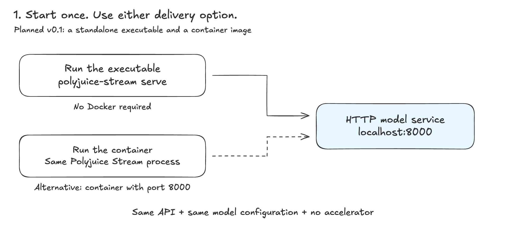
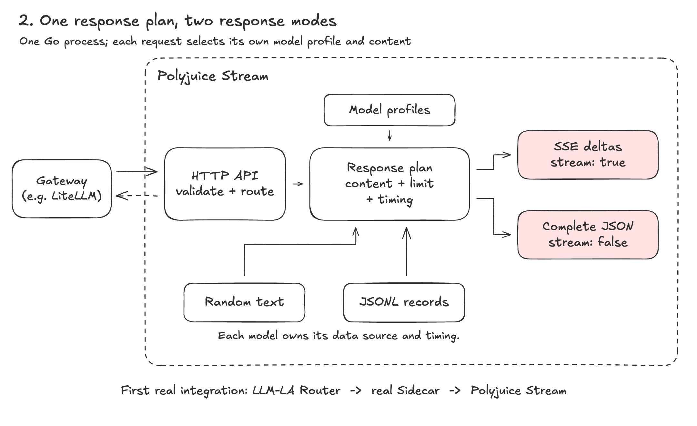
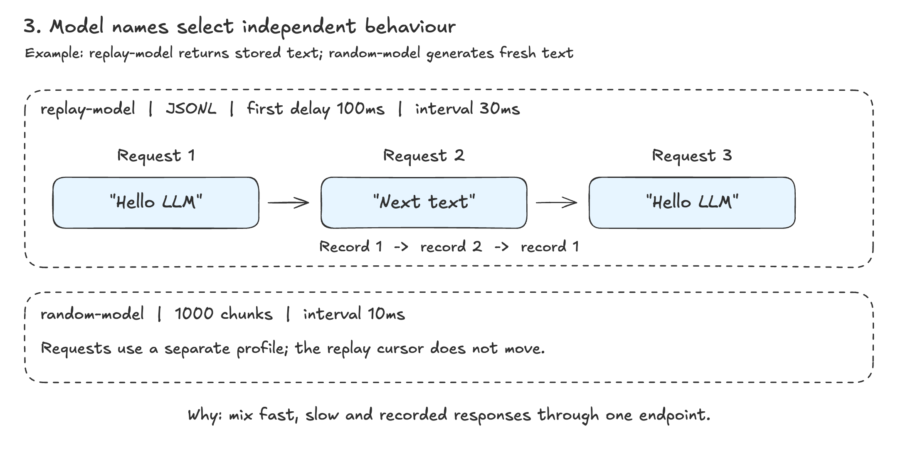
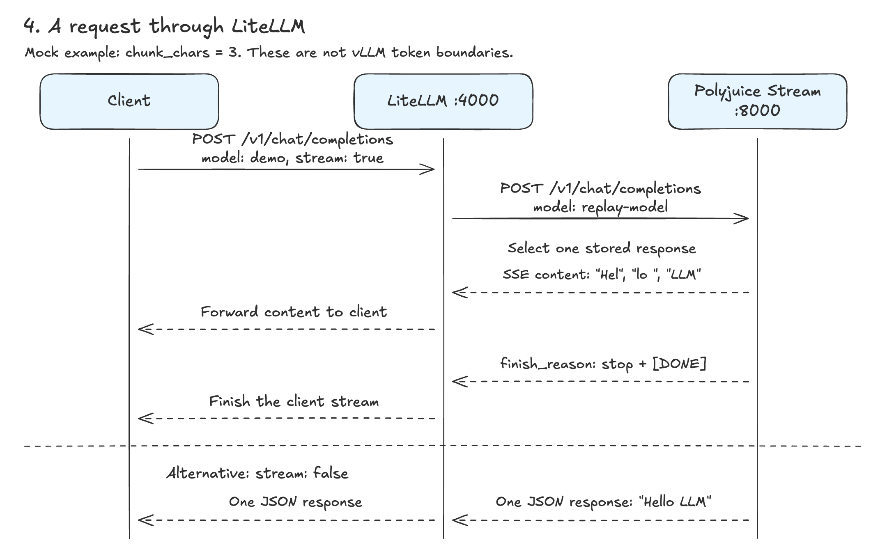
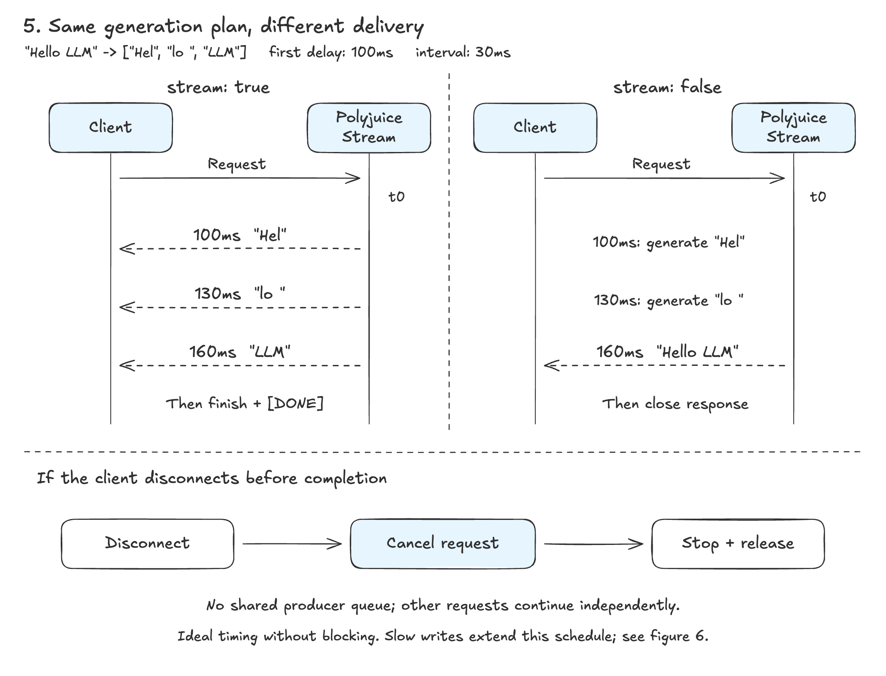
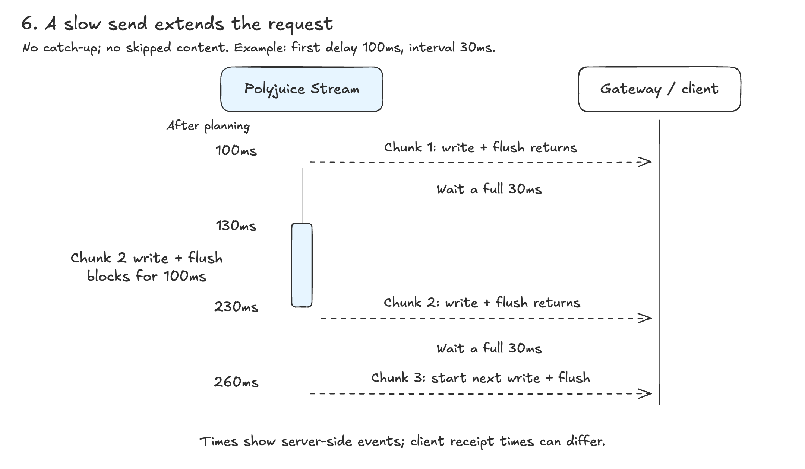

# Polyjuice Stream v0.1

> Design draft. The server, image and integrations below are planned, not implemented or tested yet.

Turn random text or recorded outputs into a callable model service with one command. Save accelerator resources while testing gateways, routers and clients.

## 1. Start and connect



Choose a standalone Go executable or a container. Both expose the same API; Docker is optional.

```sh
# Zero configuration: random output from mock-model
polyjuice-stream serve

# For the examples below: random-model + replay-model
polyjuice-stream serve --config examples/configs/multi-model.yaml
```

The equivalent container command uses a proposed local image name:

```sh
docker run --rm -p 127.0.0.1:8000:8000 \
  -v "$PWD/examples:/examples:ro" polyjuice-stream:local serve \
  --listen 0.0.0.0:8000 --config /examples/configs/multi-model.yaml
```

Choose one startup option. The [model configuration](../examples/configs/multi-model.yaml) controls each model's source, first-content delay and chunk interval.

## 2. One plan, two response modes



Select content and build a response plan once. SSE and complete JSON share its text and generation waits. Blocked streaming writes can extend the actual duration. Each request runs independently.

**First integration:** LLM-LA with its real Sidecar, initially in single-model mode with switching disabled. LiteLLM below demonstrates the ordinary HTTP boundary. Engine-specific sleep/wake controls remain outside this first integration.

## 3. Replay by example



Our [sample dataset](../examples/datasets/responses.jsonl) contains:

```jsonl
{"result":"Hello LLM"}
{"result":"Next text"}
```

`replay-model` selects record 1, record 2, then record 1 again, regardless of prompt. Every model owns its cursor. A cancelled request consumes its assigned record. Separate requests can therefore return different text—even when only `stream` changes.

## 4. Send a request through LiteLLM



Validate core fields; ignore unrelated extras such as `user`. Explicitly unsupported features such as `tools` return 400 before streaming starts.

Use this [LiteLLM configuration](../examples/configs/litellm.yaml):

```yaml
model_list:
  - model_name: demo
    litellm_params:
      model: openai/replay-model
      api_base: http://127.0.0.1:8000/v1
      api_key: unused

general_settings:
  always_include_stream_usage: false
```

```sh
litellm --config examples/configs/litellm.yaml --port 4000
curl -N http://127.0.0.1:4000/v1/chat/completions \
  -H 'Content-Type: application/json' \
  -d '{"model":"demo","messages":[{"role":"user","content":"Hello"}],"stream":true}'
```

LiteLLM maps `demo` to backend model `replay-model`. With `stream: true` and `chunk_chars: 3`, the first record arrives as `"Hel"`, `"lo "`, `"LLM"`, then a finish event and `[DONE]`. These are configured mock chunks, not vLLM token boundaries. With `stream: false`, it arrives as one assistant message. See [exact mock response examples](http-contract.md#response-examples).

Loopback addresses assume the two services share the host network namespace. Containers on a shared network should use the mock's service name. This example follows [LiteLLM's OpenAI-compatible backend configuration](https://docs.litellm.ai/docs/providers/openai_compatible).

## 5. Timing and cancellation



With negligible processing and no blocked writes, three chunks have nominal times of **100, 130 and 160ms**. Non-streaming uses the same generation waits, then returns the full text. Times start after planning.



**No catch-up, no dropped content.** After each successful write and flush, wait at least one interval. If the second write finishes at 230ms, the third starts no earlier than 260ms. These are server timings; network buffering can still group client arrivals. Cancellation stops only that request.

One output unit is one Unicode text chunk, not a real model token. `max_tokens: 2` returns `"Hello "` from the first record and finishes with `length`.

## Build and check

Random source + both modes → JSONL + multiple models → executable + container → real Sidecar integration. [Acceptance checks](http-contract.md#implementation-checks) cover pacing, cancellation and compatibility.

Keep the release small: text Chat Completions, `/v1/models` and `/health`. The [contract appendix](http-contract.md) holds field rules and integration notes; the [layout guide](repository-layout.md) explains source folders.

PNG figures are published in `assets/images/`. Editable diagram sources and SVG exports are kept locally.
